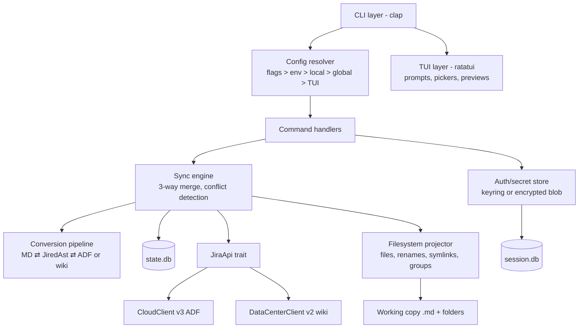

# Architecture & data model

## Components



The linchpin is **`JiredAst`**, a single internal rich-text AST. ADF and wiki markup
both parse into it; Markdown renders from it and parses back into it. Unrepresentable
nodes become `Raw(id)` AST nodes whose payloads live in `state.db.raw_block`
(see [format-conversion.md](format-conversion.md)).

## Data flows

- **fetch** — `JiraApi::search(jql, page…)` → normalize (v2/v3 differences, TZ,
  custom fields) → upsert into `state.db` remote-snapshot columns. Never touches files.
- **pull** — fetch → per issue: load *base* (state.db) + *remote* (state.db) +
  *working* (parsed `.md`) → three-way merge → projector writes files/renames/symlinks
  → base advanced to remote. Conflicts abort before any write (default strategy).
- **push** — diff working vs base → op list (D23 order) → `--dry-run` prints it →
  per issue: concurrency check (D8) → execute ops → advance base for *that issue
  only* and rewrite its file (real IDs, new `updated`).
- **diff** — purely local from parsed + cached data. No network.

## `.jired/session.db` (mode 0600)

```sql
PRAGMA user_version = 1;           -- migration counter; jired refuses versions newer
                                   -- than it knows, migrates older ones
CREATE TABLE account (
  id            INTEGER PRIMARY KEY,
  base_url      TEXT NOT NULL,          -- https://x.atlassian.net or https://jira.corp/jira
  deployment    TEXT NOT NULL CHECK (deployment IN ('cloud','datacenter')),
  auth_kind     TEXT NOT NULL CHECK (auth_kind IN ('api_token','pat','basic','cookie','oauth2')),
  identity      TEXT,                   -- email (cloud) / username (dc) / accountId
  display_name  TEXT,
  secret_ref    TEXT,                   -- keyring entry, e.g. 'jired:x.atlassian.net:ilya'
  secret_blob   BLOB,                   -- scrypt+XChaCha20 blob when keyring unavailable (D11)
  secret_kdf    TEXT,                   -- JSON kdf params, NULL when secret_ref used
  tls_ca_path   TEXT, tls_insecure INTEGER NOT NULL DEFAULT 0,
  created_at    TEXT NOT NULL, last_verified_at TEXT
);
-- oauth2 later: new auth_kind + extra columns via migration; schema anticipates it.
```

## `.jired/state.db`

```sql
PRAGMA user_version = 1;
CREATE TABLE workspace (key TEXT PRIMARY KEY, value TEXT);   -- project_key, last_fetch_at, …

CREATE TABLE issue (
  key TEXT PRIMARY KEY, id TEXT NOT NULL UNIQUE,
  -- BASE snapshot (last synced)
  base_raw     TEXT NOT NULL,       -- full raw server JSON payload
  base_updated TEXT NOT NULL,       -- server 'updated' at sync time (UTC)
  base_desc    TEXT,                -- raw ADF json / wiki string of description
  base_md_hash TEXT NOT NULL,       -- sha256 of rendered file at sync time
  -- REMOTE-TRACKING snapshot (last fetch; equals base right after pull)
  remote_raw TEXT, remote_updated TEXT, remote_fetched_at TEXT,
  file_path  TEXT NOT NULL,         -- current working-copy relative path
  parent_key TEXT, deleted_remote INTEGER NOT NULL DEFAULT 0
);
CREATE INDEX issue_updated ON issue(remote_updated);

CREATE TABLE comment (
  id TEXT PRIMARY KEY, issue_key TEXT NOT NULL REFERENCES issue(key),
  author TEXT, author_id TEXT, created TEXT, base_updated TEXT,
  base_body TEXT NOT NULL,          -- raw ADF/wiki
  remote_updated TEXT, remote_body TEXT, deleted_remote INTEGER DEFAULT 0
);
CREATE TABLE attachment (
  id TEXT PRIMARY KEY, issue_key TEXT NOT NULL, filename TEXT NOT NULL,
  size INTEGER, mime TEXT, sha256 TEXT, author TEXT, created TEXT,
  downloaded INTEGER NOT NULL DEFAULT 0
);
CREATE TABLE raw_block (            -- lossy-region preservation
  id TEXT PRIMARY KEY,              -- short id in <!--jired:raw:ID--> placeholder
  issue_key TEXT NOT NULL, container TEXT NOT NULL,  -- 'description' | 'comment:<id>'
  ordinal INTEGER NOT NULL, node_json TEXT NOT NULL, -- exact ADF/wiki fragment
  approx_md TEXT                    -- read-only rendering shown between markers
);
CREATE TABLE pending_op (           -- durable push journal
  id INTEGER PRIMARY KEY, issue_key TEXT NOT NULL, kind TEXT NOT NULL,
  payload TEXT NOT NULL, status TEXT NOT NULL DEFAULT 'pending'
    CHECK (status IN ('pending','done','failed')),
  error TEXT, created_at TEXT NOT NULL
);
CREATE TABLE conflict (
  id INTEGER PRIMARY KEY, issue_key TEXT NOT NULL, field TEXT NOT NULL,
  base_val TEXT, ours_val TEXT, theirs_val TEXT,
  resolved TEXT CHECK (resolved IN (NULL,'ours','theirs','manual'))
);
CREATE TABLE sprint (id TEXT PRIMARY KEY, board_id TEXT, name TEXT, state TEXT, raw TEXT);
CREATE TABLE board  (id TEXT PRIMARY KEY, name TEXT, type TEXT, columns_json TEXT);
CREATE TABLE field_meta (field_id TEXT PRIMARY KEY, name TEXT, schema_json TEXT, well_known TEXT);
CREATE TABLE transition_cache (issue_key TEXT, tid TEXT, name TEXT, to_status TEXT,
  required_fields TEXT, fetched_at TEXT, PRIMARY KEY (issue_key, tid));
```

Migrations: numbered embedded SQL scripts applied in one transaction, gated on
`PRAGMA user_version` (hand-rolled, ~50 lines).

`state.db` is a **cache plus the `pending_op` journal**: deleting it and re-running
`jired fetch` must always be a safe recovery path (D17).

## Frontmatter schema (exact)

```yaml
key: PROJ-142            # RO (identity; edit = error)
id: "10023"              # RO (edit = error)
type: Story              # editable (issue-type move; validated)
status: In Progress      # editable → staged transition (validated)
priority: High           # editable
summary: Fix login flow  # editable (drives rename, D6/D7)
labels: [auth, backend]  # editable
components: [web]        # editable
assignee: "@[Ilya A](5b10a2…)"   # editable; `me` accepted as shorthand
reporter: "@[Jane D](5b1af9…)"   # RO
created: 2026-08-01T09:12:00Z    # RO
updated: 2026-08-16T14:03:00Z    # RO
sprint: "Sprint 42"      # editable
parent: PROJ-100         # editable
epic: PROJ-90            # editable (cloud: parent; dc: epic-link custom field)
fix_versions: [2.4.0]    # editable
affects_versions: []     # editable
links:                   # editable (typed issue links)
  - blocks: PROJ-150
  - relates to: PROJ-99
url: https://x.atlassian.net/browse/PROJ-142   # RO
story_points: 5          # editable (well-known custom field)
custom:                  # unknown customs, round-trip untouched; edits pushed as-is
  customfield_10456: {value: "Platform"}   # unless listed in ignored_custom_fields
jired:                   # RO sync block — local edits ignored with a warning
  base_updated: 2026-08-16T14:03:00Z
  base_version: 7
  content_hash: sha256:9f2c…
  lossy: false
```

Edits to RO fields: warning + ignored (rewritten correctly on next pull);
edits to `key`/`id`: hard error.

## JSON output versioning (D19)

Every stdout JSON object and stderr JSON error carries `"schema": "jired/<name>/1"`.
Breaking changes bump the integer; additive changes do not. `jired schema [name]`
prints the JSON Schemas so agents can validate.

Error shape (stderr in `--json` mode):

```json
{"schema":"jired/error/1","code":5,"kind":"conflict","message":"…","details":{}}
```
